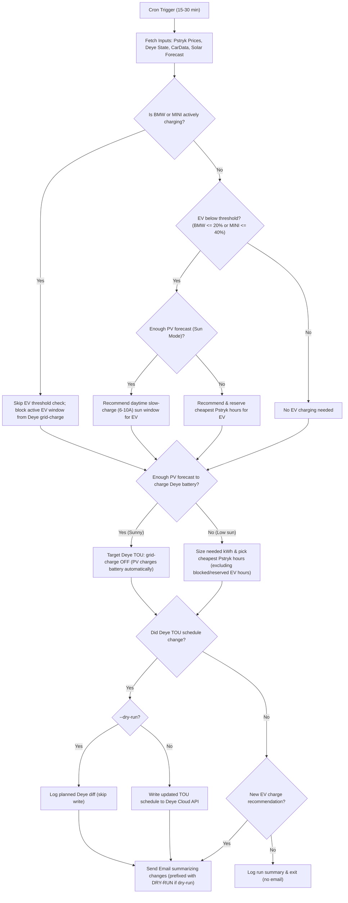

# ⚡ `pstryk-pilot` — Execution Plan

An automated, headless Home Energy Management System (HEMS) written in Python (`uv`), triggered by `cron` to optimize **Deye SUN-10K-SG04LP3-EU** battery charging and **BMW / MINI** charging recommendations using **Pstryk** dynamic tariffs and solar forecasts.

---

## 1. Confirmed Requirements & Design Summary

| Area | Decision |
| :--- | :--- |
| **Stack & Runtime** | Python 3.12+ managed with `uv` (`pyproject.toml`, `uv.lock`). No UI; CLI entrypoint triggered by `cron` on Linux/macOS/Docker every 15–30 minutes. |
| **Deye Control** | **Deye Cloud / Solarman Open API** behind a clean `InverterClient` interface (allowing future local Modbus/Solarman V5 drop-in). |
| **Vehicle Telemetry** | **BMW CarData API (read-only)** for BMW (trigger `<= 20%` SoC) and MINI (trigger `<= 40%` SoC). |
| **EV Charging Coordination** | Manual EV charging in v1 via email alerts. **EV priority & strict non-overlap:** if CarData reports an EV is already actively charging, skip EV threshold checks and block active hours from Deye grid-charging. Otherwise, if an EV is `<= threshold`, EV gets the best window (sun slow-charge in summer, cheapest hours in low-sun) and Deye grid-charging uses non-overlapping hours. |
| **Deye Battery Strategy** | **Grid-charge only when solar is insufficient:** if PV forecast is strong enough to charge the battery, disable Deye TOU grid-charging (`OFF`) so the battery charges purely from PV. Only when forecasted PV is insufficient, dynamically size needed kWh (`target_soc - current_soc - expected_pv`) and enable grid-charging in the cheapest non-overlapping hours. |
| **Summer / Sun Optimization** | Automatic via **Open-Meteo / Forecast.Solar** (lat/lon + kWp) + real-time Deye PV telemetry. Strong PV turns **OFF** Deye grid-charging (solar charges battery automatically) and recommends daytime **slow-charge (6–10A)** EV windows for self-consumption. |
| **Notifications** | Standard **SMTP** sent **whenever actionable changes occur** — i.e., any Deye TOU schedule change (including blocking grid-charge hours when an EV starts charging or turning grid-charge OFF for sunny weather) or a new EV charge recommendation — plus critical errors. No email if no changes occur. |
| **Dry-Run Mode** | `--dry-run` (or `DRY_RUN=true`): runs all read APIs and decision logic, logs planned Deye mutations, **skips all Deye write calls**, and **sends change/alert emails prefixed with `[DRY-RUN]`** (no email if no changes are expected). |
| **Logging & Audit** | Structured rotating logs (file + stdout) recording every API snapshot, decision rationale, Deye diff, and notification event. |

---

## 2. Proposed Project Structure

```text
pstryk-pilot/
├── pyproject.toml
├── uv.lock
├── .env.example
├── README.md
├── docs/
│   └── planning/
│       ├── execution-plan.md
│       ├── adr-001-initial-architecture.md
│       └── tasks.md
├── src/
│   └── pstryk_pilot/
│       ├── __init__.py
│       ├── main.py            # CLI entrypoint (`pstryk-pilot run --dry-run`)
│       ├── config.py          # Pydantic settings (thresholds, battery kWh, SMTP, lat/lon, kWp)
│       ├── logging_setup.py   # Rotating file + structured console logging
│       ├── state.py           # JSON/SQLite state store (alert cooldowns, last Deye schedule)
│       ├── models.py          # Domain models (PriceSlot, VehicleState, InverterState, Plan)
│       ├── clients/
│       │   ├── pstryk.py      # Pstryk API client (today & next-day hourly prices)
│       │   ├── deye.py        # Deye Cloud / Solarman Open API client (read SoC/PV, write TOU)
│       │   ├── cardata.py     # BMW CarData client (BMW & MINI SoC + charging status)
│       │   └── solar.py       # Open-Meteo / Forecast.Solar PV forecast client
│       ├── engine/
│       │   ├── planner.py     # Decision engine (EV priority, PV offset, non-overlapping Deye slots)
│       │   └── diff.py        # Computes exact Deye TOU changes & avoids redundant API writes
│       └── notify/
│           └── email.py       # SMTP sender + `[DRY-RUN]` prefixing + message templates
└── tests/
    ├── test_planner.py        # Unit tests for summer PV, EV conflict, dynamic SoC sizing
    ├── test_diff.py
    └── fixtures/              # Sample Pstryk, Deye, CarData, and solar payloads
```

---

## 3. Core Decision Engine Flow (Per Cron Run)



---

## 4. Phased Implementation Plan

### Phase 1: Project Scaffolding & Config (`uv`)
- Initialize `pyproject.toml` with `uv` (`httpx`, `pydantic-settings`, `structlog` or `loguru`, `pytest`, `ruff`).
- Implement `config.py`, `.env.example`, rotating logger, and CLI entrypoint (`--dry-run`, `--once`).
- Add `state.py` for persisting last-notified vehicle timestamps/SoC and last-applied Deye TOU schedule.

### Phase 2: Read-Only API Clients & Fixtures
- **Pstryk client:** Fetch hourly prices for today and tomorrow (handling Day-Ahead publication timing).
- **Deye Cloud / Solarman Open API client (read):** Authenticate, read battery SoC, current PV power, and current TOU slots.
- **BMW CarData client:** Read BMW and MINI SoC, plug status, and active charging flag.
- **Solar forecast client:** Fetch hourly irradiance/PV estimate from Open-Meteo for home coordinates.
- Record anonymized JSON fixtures for offline testing.

### Phase 3: Decision Engine & Non-Overlap Planner
- Implement `planner.py` with pure, deterministic functions:
  - EV threshold detection (`BMW <= 20%`, `MINI <= 40%`) & active-charging detection.
  - Summer/sun slow-charge window selection vs. cheapest-tariff window selection.
  - Dynamic Deye kWh calculation and non-overlapping cheapest-hour selection mapped to Deye's 6 TOU slots.
- Write thorough unit tests in `tests/test_planner.py` covering winter/summer, EV active charging, dry-run, and edge cases (e.g., missing tomorrow prices before 14:00).

### Phase 4: Deye Write Adapter & SMTP Notifications
- Implement Deye TOU schedule write call with idempotency diffing (only write when slots actually change).
- Implement SMTP emailer with alert deduplication and `[DRY-RUN]` subject/body formatting.

### Phase 5: Dry-Run Validation & Cron Deployment
- Run in `--dry-run` mode via `cron` for several days, reviewing logs and `[DRY-RUN]` emails.
- Enable live Deye writes once schedules match expectations.
- Provide `Dockerfile` / `crontab` example in `README.md`.
